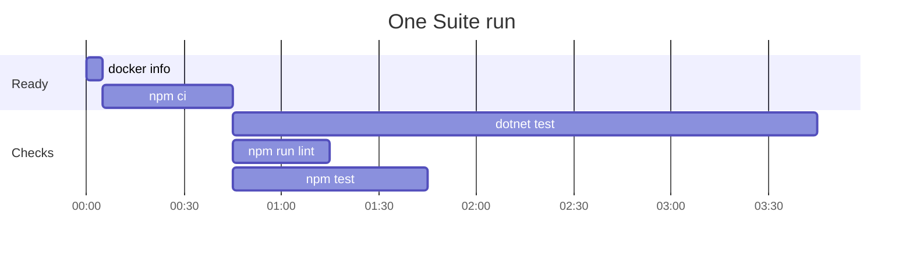

# The Suite

The Suite is the checks your repo names for the loop to run before a ticket Lands. Your team owns the
list, so your team says what green means for its own code. The loop runs the checks the Suite file
names and nothing else.

## The Suite file

The Suite file is `docs/skillworks/suite.json`. Setup seeds it with no checks, so a new repo starts by
adding its own:

```json
{
  "runs": 1,
  "checks": [
    {
      "command": ["dotnet", "test"],
      "folder": ".",
      "ready": {
        "command": ["docker", "info"],
        "message": "Docker does not answer. Start Docker and run this again."
      },
      "ignores": ["docs", "web"]
    },
    {
      "command": ["npm", "run", "lint"],
      "folder": "web",
      "ready": {
        "command": ["npm", "ci"],
        "message": "The front end has nothing installed, and npm ci would not install it.",
        "unless": "web/node_modules"
      }
    },
    {
      "command": ["pytest", "scripts"],
      "folder": ".",
      "image": "docs/skillworks/scripts.Dockerfile"
    }
  ]
}
```

### Under Sidecar Steering

Under Sidecar Steering, the Suite file sits in the Sidecar, at
`docs/skillworks/suite.json` there, and the repo holds none. The Suite reads it from the Sidecar, and
builds each `image` from the Dockerfile the Sidecar holds at that path. Every other path in the file,
such as a `folder` or an `ignores`, is still a path in the repo.

A Proof knows the Sidecar's Steering as well: every file under `docs/skillworks/` in the Sidecar, its
`CLAUDE.md`, and the Dockerfile of the check. A change to one of them runs every check again, so a
stale Proof never passes. The specs and tickets in the Sidecar are not Steering, so closing a ticket
runs nothing again.

## What a check holds

| Key | What it does |
|---|---|
| `command` | The program and its arguments, one word to an entry. The loop starts it with no shell. |
| `folder` | Where the command runs, from the repo root. |
| `ready` | Optional. A command that proves the machine can run the check, such as `docker info`, and the `message` the loop prints when it fails. With `unless`, a path from the repo root, the loop skips the command when the path is there, so an install is not done twice. |
| `ignores` | Optional. The paths the check cannot be changed by. See below. |
| `image` | Optional. A Dockerfile in the repo, from the repo root, or in the Sidecar under Sidecar Steering. The check runs in that image. See below. |
| `rerun` | Optional. A **Rerun**: a command with the same shape as `command`, run in the check's `folder`. On the runs after the first, a check that went red on the run before runs it in place of `command`. The loop reads no output, so your command finds the tests that went red itself, such as from a results file the first run wrote. It is not allowed with `image`, because a check in an image runs on a copy of the files, so its Rerun cannot read what the first run left. |
| `prebuild` | Optional. The name of a **Prebuild** under `prebuilds`, beside `checks`. The loop runs it once, before the checks that name it, so they need not build what they test. A Prebuild that fails is red for every check that names it: each one shows what the Prebuild said, does not run, and keeps no Proof. It is not allowed with `image`, because a check in an image runs on a copy of the files, apart from what the Prebuild built. |

`prebuilds`, beside `checks`, names each Prebuild, with a `command` and a `folder` in the shape of a
check's:

```json
"prebuilds": {
  "build": { "command": ["dotnet", "build", "Shop.slnx"], "folder": "." }
}
```

A check that names a Prebuild the file does not hold is turned down, and the loop stops with the Suite
not ready. A Prebuild keeps no Proof of its own, because it proves nothing alone. It is part of each
check that names it, so an edit to it runs each of those checks again.

`runs`, beside `checks`, says how many times the loop runs a red Suite before it believes it. It is 1
when the file leaves it out. With `runs` at 2 or more, a check that goes red and then passes on the
same inputs is a **Flake**. A Flake counts as green, so it does not stop the loop. It is always
reported: the Suite output names each Flake after the last run, and keeps what it said when red. Set
`runs: 2` when your checks fail now and then for reasons that are not the code, such as a busy
machine or a process that crashes at random. Leave it at 1 when every red is real, because a second
run of a real red only costs time. On the runs after the first, a check with a `rerun` runs it in
place of its whole command, so a Flake costs the tests that went red and not the whole check. Red and
then green on the Rerun is a Flake too. With `runs` at 1, no Rerun runs.

## `baseline`: the quick check of the Target branch

`baseline`, beside `checks`, is optional. It names the quick command that shows the code compiles,
such as a build of the solution:

```json
"baseline": {
  "command": ["dotnet", "build", "Skillworks.slnx"],
  "folder": "."
}
```

`baseline` takes a `command`, a `folder` and an `image`, read as a check reads them. It takes no
`ignores` and no `ready`, and any other key makes the Suite file one the loop cannot read. It keeps
no Proof and reads none, so it runs on every run.

The loop runs it in the [Baseline](the-loop.md), on the Target branch, before the Cut. It runs on the
host, or in its image when it names one. When it fails, the run stops and no Session is asked to mend
it, because the fault was on the Target branch before the spec began. A Suite file with no `baseline`
still works, and the Baseline then checks only that the machine is ready.

## Proofs: a check never proves the same thing twice

Each time a check passes, the Suite keeps a **Proof**: the check, and the exact inputs it passed on.
A check whose inputs match a Proof does not run. Its line in the Suite output says it did not run,
and names the Proof and when it was made. A Suite in which every check has a Proof passes.

A check's inputs are every file in the worktree that git does not ignore, less the check's
`ignores`. Uncommitted and untracked files count. The Suite reads each file as it is on disk. The
check's own entry in the Suite file counts too, so an edit to its `command`, `folder`, `ready`,
`ignores`, `image`, `rerun` or `prebuild`, or to the Prebuild it names, runs it again.

- Only a check that passes keeps a Proof. A red check keeps none.
- After a red Suite, a red check whose inputs did not change is red again at the ticket's next Suite
  step, with no run. Its line says it did not run, names the earlier red on the same inputs, and
  shows what the check said then. A `fix` that changes nothing costs no run.
- The loop keeps that red in memory, for one ticket. It writes nothing to disk, and a new ticket
  starts with no kept red. `skillworks-suite`, the landing and the full run keep no red, so they run
  a red check again.
- Proofs stay in your clone, in its git folder. Every worktree and every loop in the clone shares
  them. Nothing pushes them, so a pass on another machine never counts here.
- A ticket pays only for the checks its change can reach. After a red Suite, only the checks whose
  inputs the fix changed run again. A landing after a rebase runs only what is new.

## `ignores`: the paths a check cannot be changed by

A check with `ignores` lists paths from the repo root, as git pathspecs. A folder, a file and a
pattern such as `src/*.json` all work. A change to one of those paths does not run the check again.
A check without `ignores` runs again when any file changes.

Name what the check ignores, not what it reads. A path you forget to ignore costs time: the check
runs when it did not need to. It never lets a red change land. So start with no `ignores`, and add
them only to a slow check, where they save minutes.

Before you ignore a path, make sure no test reads it. A test that reads a doc is changed by that doc.

A Suite file that still gives a check `when` is turned down, and the loop stops with the Suite not
ready. `when` listed the paths that woke a check. To rewrite it, delete `when` and list under
`ignores` the paths the check cannot be changed by. Or delete `when` and add nothing: the check then
runs again on any change, which is always safe.

## `image`: a check that runs in a container

Some tests start many processes, and some OSes are slow to start one. A check with `image` names a
Dockerfile, so the check runs on an OS that is fast for it. Keep the Dockerfile in `docs/skillworks/`
with the rest of your Steering.

1. The loop builds the image. Docker keeps what it built before, so a second build is fast.
2. It copies the check's inputs into a new container: every file git does not ignore, less the
   check's `ignores`. Uncommitted and untracked files go in too. A file git ignores, or the check
   ignores, does not.
3. It runs the `command` in the container, from the check's `folder`. The container's output and
   exit status are the check's.
4. It removes the container, red or green.

A Session runs the tests of a check with `image` as a Trial, below, and never on the host.

The Dockerfile is one of the check's inputs, unless the check ignores it. So a new image runs the
check again.

A check with `image` needs Docker on the machine, and not its own program. If `docker info` fails,
the machine is not ready, and the loop stops as it does for a failed `ready` command.

A copy made on Windows keeps the line endings of your checkout. A shell script with CRLF endings
fails in Linux, so check out every `.sh` with LF, in `.gitattributes`:

```
*.sh text eol=lf
```

## `checks-from`: checks a command prints

An entry in `checks` can hold `checks-from` in place of `command`. It names a **Check maker**: a
command, in the shape of `command`, that runs in the entry's `folder` and prints checks. The loop
runs the printed checks as if your file named them, beside the checks your file names itself.

```json
{
  "checks-from": ["make-checks", "Shop.slnx"],
  "folder": ".",
  "ready": { "command": ["docker", "info"], "message": "Start Docker." },
  "ignores": ["docs"]
}
```

The Check maker prints JSON: `checks`, a list of checks in the shape of a check in your file, and
`prebuilds`, the Prebuilds those checks name. A printed check can name only a Prebuild that the same
Check maker printed.

```json
{
  "prebuilds": { "build": { "command": ["dotnet", "build", "Shop.slnx"], "folder": "." } },
  "checks": [
    { "command": ["dotnet", "test", "tests/Shop.Tests", "--no-build"], "folder": ".", "prebuild": "build" }
  ]
}
```

- **It runs at each Suite run**, before the loop works out keys and Proofs. So a new project gets
  its check with no edit to your file.
- **The keys beside `checks-from` reach every check it prints.** `ready` is set on each one.
  `ignores` is added to each check's own `ignores`. The entry is part of each printed check's key,
  so an edit to the entry runs all of them again. A change in what the Check maker prints for a
  check runs that check again.
- **A Check maker that fails is red.** When it exits with an error, or prints JSON the loop cannot
  read, the output shows one red line named for the Check maker, with what it said. The Suite is
  red, and the checks your file names itself still run.
- **The output lists each printed check** in the place of its entry, in the order the Check maker
  printed them, with what it said or the Proof that held its inputs.
- **The full run** runs each Check maker and every check it prints, and trusts no Proof.

### `max-parallel`: how many printed checks run at once

An entry that holds `checks-from` can hold `max-parallel`, a whole number of 1 or more. No more than
that many of the checks the entry prints run at the same time. Every other check still starts at
once: the checks your file names itself, and the checks of other `checks-from` entries. With no
`max-parallel`, every printed check starts at once.

- **A check holds its place while it runs its command or its Rerun.** So a Rerun takes the check's
  own place, and never runs beyond the cap.
- **A Prebuild takes no place.** It runs before its checks, as it does with no cap.
- **A check that does not run takes no place**: one whose Proof holds its inputs, or one red on the
  same inputs at this ticket's Suite step before.
- **The Suite refuses a bad `max-parallel`.** A `max-parallel` of 0, a negative number, a number
  with a fraction, or text, makes the Suite file one the loop cannot read. So does `max-parallel` on
  an entry that holds `command`, because a cap on one check means nothing.

The cap belongs to the Suite, so it works with any Check maker. The Check maker prints nothing about
it.

## A .NET solution

The Plugin ships a Check maker for .NET, `suite-dotnet-checks`. Give it a solution, and it prints
one check for each test project in it. One entry in your Suite file then covers every test project,
and a new test project gets its check with no edit:

```json
{
  "checks-from": ["suite-dotnet-checks", "Shop.slnx", "--skip", "*.E2E.Tests"],
  "folder": ".",
  "ready": {
    "command": ["docker", "info"],
    "message": "Docker does not answer, and the tests need SQL Server in a container. Start Docker."
  },
  "ignores": ["docs", "web"]
}
```

It reads `.sln`, `.slnx` and `.slnf` files, and the `ProjectReference` items of each project file, as
text. It runs no `dotnet` command, so it takes a moment and builds nothing.

`IsTestProject` in the project file decides which projects get a check. `true` gets one, and `false`
gets none, whatever packages the project names. The value counts in any letter case. A test support
library that sets `<IsTestProject>false</IsTestProject>` gets no check, even when it names
`Microsoft.NET.Test.Sdk` or `xunit.v3`. The Check maker reads the project file only. A value set in a
`Directory.Build.props` or `Directory.Build.targets` file is not read, and neither is one under a
`Condition`, on the element or on its `PropertyGroup`. Use `--skip` for those projects.

The packages decide only when the project file does not set `IsTestProject`. Then a test project is
one that names `Microsoft.NET.Test.Sdk` or `xunit.v3` in a `PackageReference`, in any letter case. So
a pure Microsoft.Testing.Platform project that drops `Microsoft.NET.Test.Sdk` still gets a check. `xunit.v3`
counts only as that exact name. A library that names only `xunit.v3.assert`,
`xunit.v3.extensibility.core` or another `xunit.v3.*` package is not a test project, and gets no
check.

It prints one Prebuild, `dotnet build` on the solution you gave it. Each check it prints holds:

- **Its command**: `dotnet test` on its test project, with `--no-build`, because the Prebuild built
  it. It writes a TRX results file to `TestResults` in the test project's own folder, so no two
  checks share one. Keep `TestResults` in your `.gitignore`, or each results file is a change.
- **Its Prebuild**: the one the Check maker printed. So the loop builds the solution once, and the
  tests then run together.
- **`ignores` from the project graph**: the folder of every project in the solution that its test
  project does not reach, directly or through other projects. A change to a project it does not
  reach keeps its Proof. A file outside every project folder, such as `Directory.Build.props`,
  `global.json` or test data, is never ignored, so a file the graph does not show never lets a red
  land. A folder that holds a project the test project reaches is never ignored either.
- **Its Rerun**: `suite-dotnet-rerun`, which the Plugin ships. It runs only the tests that went red.
  It reads the TRX file that the check's last run wrote, and runs `dotnet test --no-build` with a
  `--filter` that names each red test. Under Microsoft.Testing.Platform the filter takes another form,
  as the section below says. It reads no output of the Suite. When the TRX file is
  missing, or names no red test, it runs the check's whole command. So a Flake in a slow test
  project costs seconds, and not the whole project's time.

`--skip` takes a pattern, and a test project whose name matches it gets no check. `*` matches any
run of characters, and nothing else is a wildcard. Give `--skip` once for each pattern.

To add flags to each `dotnet test` command, put them after a `--` at the end of the `checks-from`
line, after the solution and any `--skip`. Every word after the `--` is a flag, so a `--skip` there
is passed on and skips nothing:

```json
"checks-from": ["suite-dotnet-checks", "Shop.slnx", "--skip", "*.E2E.Tests",
                "--", "--blame-crash", "--blame-crash-dump-type", "mini"]
```

Under VSTest the flags go at the end of each printed command. Under Microsoft.Testing.Platform they
go after the command's `--`, after the TRX flags, because there the test app reads them. Each Rerun
runs the same command, so it carries the flags too.

When your test projects share one database server, it may not take every project's tests at once.
Give the entry `max-parallel`, as the `checks-from` section says, so no more than that many test
projects run together:

```json
{
  "checks-from": ["suite-dotnet-checks", "Shop.slnx"],
  "folder": ".",
  "max-parallel": 4,
  "ready": {
    "command": ["docker", "info"],
    "message": "Docker does not answer, and the tests need SQL Server in a container. Start Docker."
  }
}
```

The lint and the front-end tests still start at once, and do not wait behind the .NET tests.

### The test runner: VSTest or Microsoft.Testing.Platform

The Check maker reads `global.json` as text to find your test runner. It looks in the repo root
first, then in each folder above it, and the nearest `global.json` wins. That is where `dotnet` looks,
because every printed check runs from the repo root. A `global.json` beside a solution in a subfolder
is not read.

The runner is Microsoft.Testing.Platform (MTP) when `global.json` names it:

```json
{
  "test": { "runner": "Microsoft.Testing.Platform" }
}
```

With no `global.json`, or one that names no runner or names VSTest, the runner is VSTest, and every
check is printed as above.

Under MTP each check's command is:

```
dotnet test --project <project> --no-build --results-directory <project folder>/TestResults
  -- --report-xunit-trx --report-xunit-trx-filename <project name>.trx <your flags>
```

`--results-directory` is a `dotnet` flag, so it goes before the `--`. The TRX file is written by
xUnit's own TRX flag, so you need no extra TRX package. It lands in the same folder as under VSTest.

Under MTP the Rerun is `suite-dotnet-rerun --mtp`. It adds one `--filter-method` for each red test,
with the test's full method name, at the end of the command, after its `--`. When the TRX file is
missing, or names no red test, it runs the whole command, as under VSTest.

Under MTP only xUnit v3 is supported. A test project that does not name `xunit.v3` makes the Check
maker refuse. That holds for a project that `<IsTestProject>true</IsTestProject>` makes a test
project too. A project that sets it to `false` is never refused. The refusal names the project and
says that only xUnit v3 is supported under Microsoft.Testing.Platform. The Suite shows it red, as for
any Check maker that fails.

`ready` and `ignores` beside `checks-from` reach every check it prints, as for any Check maker.

## How the loop runs the Suite

The Suite runs once for each ticket after the build, the reviews, the fix and the comment sweep.
Before the ticket Lands, it rebases onto the newest Target branch, and if the Target branch moved,
the Suite runs again on the new base. A check whose inputs a Proof holds does not run, so that
second run is usually short. No Session in the loop runs the whole Suite. The driver runs it, reads
the exit status itself, and keeps the output. Each Session, the build, the reviews and the fix alike,
runs only Trials: the few tests near its work, where their check runs.

1. **Ready first.** Every program a check that will run needs must be on `PATH`. Then the `ready`
   command of each check that will run runs, one by one, because two checks can share one install.
   A check with a Proof needs nothing from the machine. A machine that is not ready is not a red
   Suite. The loop stops and prints the `message`, and no Session is asked to fix it, because no
   Session can start Docker. On Windows the Suite starts a command with no file extension, such as
   `suite-dotnet-checks`, through `bash`, so Git Bash must be on `PATH`.

   Each `ready` command also runs at the start of every run, in the [Baseline](the-loop.md), before
   the Cut. There the `ready` command of every check runs, with a Proof or not, unless its `unless`
   path is there. A machine that is not ready stops the run before any Session starts. The `ready`
   check above still runs at each Suite step, so a container that stops during a long run still
   stops the loop.
2. **Then the Prebuilds run, once each.** A Prebuild runs when one or more of the checks that name
   it will run, however many name it. A Prebuild whose checks all have a Proof, or a red kept from
   this ticket, does not run. The Prebuilds run one after the other, because two of them can build
   the same files. A Prebuild that fails is a red Suite, never a machine that is not ready, because
   code that does not compile is the ticket's to mend.
3. **Then the checks run together.** So a Suite takes as long as its slowest check, and not the sum
   of them all. A check that names a Prebuild builds nothing, so checks that share a library never
   build it at the same time.
4. **A red check lets the others finish.** The fix step then reads every failure at once. The Suite
   is red when any check is red.
5. **The output keeps the order of the file.** Each check's output is whole, whatever finished
   first, so two runs of one Suite read the same.



The readiness commands run one after the other. The three checks start together, and the Suite
ends when `dotnet test`, the slowest, ends.

## The full run

A Proof knows only the files in the repo. A change outside the repo, such as a new SDK, can leave a
Proof stale. So after each loop run that landed at least one ticket, the driver runs the whole Suite
again on the newest Target branch from `origin`, in a new worktree. It runs once, at the end, after
the drift check. It does this when the loop stopped early too, because the tickets that landed are on
the Target branch all the same.

The full run trusts no Proof and uses no image. Every check runs, on your own machine, so the code is
proved on the OS your team uses. It keeps no Proof. A check that goes red there loses all its
Proofs, so a stale Proof cannot skip it again.

A red full run stops the loop. The report names the red checks and the tickets that landed in the
run. The spec stays open, and no Session is asked to fix it: a red Target branch is yours to
decide on.

A full run with a red or a Flake leaves its worktree in place, so a crash dump or a log a tool
wrote there survives for you to read. A full run with neither removes its worktree. The next full
run of that spec removes a left worktree before it opens its own. If the left worktree will not go,
the run stops and names its path.

## Running the Suite yourself

`skillworks-suite` is the Plugin's command for the Suite. It runs the Suite in the worktree you are
in, with Proofs, as the loop does. The Proofs it keeps count for the loop. Point an agent you drive by
hand at it, in your `CLAUDE.md`, in place of your raw test commands. A Session in the loop does not
run it over the whole Suite: it runs only Trials, and the driver runs the Suite.

`skillworks-suite --fresh` is the full run, by hand. It trusts no Proof, uses no image, keeps no
Proof, and takes away the Proofs of a check that goes red. Run it when you want to prove the Target
branch yourself.

## A Trial: some of a check's tests, in its image

A **Trial** runs a command of your own in the image a check names. It is for the few tests your
change touches, when the check that runs them runs in an image:

```
skillworks-suite --image docs/skillworks/scripts.Dockerfile -- pytest scripts/suite_test.py -k proof
```

The form is `skillworks-suite --image <Dockerfile> -- <command>`. Name the image by the path the
Suite file gives it. Everything after `--` is the command, one word to an argument.

1. It builds the image, as the check does.
2. It copies the check's inputs into a new container, the same copy a run of the check makes.
   Untracked files go in. Paths the check ignores, and tracked files you deleted, do not. When two
   checks name the image, a path goes in unless both of them ignore it.
3. It runs the command from the folder you are in, at its place under `/repo` in the container, so a
   relative path means the same thing there. It prints what the command printed, and exits with its
   exit code. A Trial started from a folder outside the repo is refused.
4. It removes the container, however the Trial ends.

A Trial keeps no Proof, reads none and forgets none. Part of a check never stands in for the whole
check, so the Suite judges the same Proofs after a Trial as it would have judged with no Trial.

A Trial refuses an image that no check in the Suite file names. It needs Docker, and if `docker info`
fails, it stops with the Suite's own message.

## A red Suite

A red Suite on every one of its `runs` belongs to the ticket. The loop goes back to the fix step, then
the comment sweep, then the Suite, once. Red again stops the loop, and the ticket stays open.

Set `runs` above 1 only if your tests flake. A Session handed a failure it cannot reproduce may weaken
a test, or change code that was never broken. With `runs` at 2, the loop runs a red Suite a second
time before it acts. A check that passed is proved now, so the second run runs only the red checks.
Every run's output is kept in the step's record, so you can read a flake afterwards.
