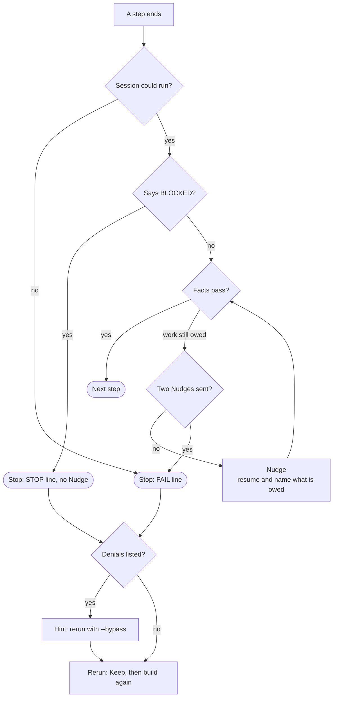

# When a step fails

Part of [the Dev loop](../the-loop.md).



**A Nudge.** A Session can stop before its work is done: no report written, nothing committed, the
ticket still open. The script then resumes that same Session and names what is still owed, so it
carries on with what it knows. The Nudge also says that nobody will answer a question, and what to do
with a choice the Session put to a person. That part follows the kind of step:

- **A step that builds** (the build, `fix` and the Cut) makes that Choice itself, within what its
  step allows, and writes a `CHOSE` line.
- **A step that judges** (the three reviews, `sweep`, the drift check and the Name check) makes no
  Choice. A review reports the choice as a finding, and a check gives the Verdict.
- **Finishing** closes the ticket, with the question and the build's answer in the Closing note.

Every Nudge also says that a command left in the background was stopped, and when to answer
`BLOCKED`. Two Nudges are the limit. A step that still owes work after them stops the loop. A
Session that could not run at all, such as one that ended in an error or never loaded its command,
gets no Nudge. It stops the loop at once.

**A Nudge for the Cut.** The Cut is Nudged too, when the Tracker holds no ticket after it. Its Nudge
names what is missing and the command that records it, then ends as every Nudge does. Each Nudge
writes a `NUDGE` line. A Cut that still filed nothing after two Nudges stops the loop with a `STOP`
line, as [the tickets](tickets.md) says.

**A Nudge for the checks.** The drift check and the Name check are Nudged too, when the Tracker holds
no report after them, and so are their re-checks, when the Tracker holds no new report. The Nudge
names what is missing and the command that records it, then ends as every Nudge does, and writes a
`NUDGE` line. A check that still recorded nothing after two Nudges stops the loop with a `STOP`
line. Only a missing report earns a Nudge. A report with no Verdicts list, a tree left changed and a
non-zero exit stop or warn as before, with no Nudge.

**A Blocked step.** A Session that cannot do its work begins its report with a line that starts
with `BLOCKED`, as [Sessions](sessions.md#nobody-answers-in-the-loop) says. The script reads only the
first line of the report that is not empty, so a `BLOCKED` lower down does not count. It reads it
after the facts that show the Session could run, and before the facts that show the work was done. A
Blocked step stops the loop at once, at that step, even when every fact passes. A Blocked build stops
the loop before the reviews run. No Nudge is sent, and a Blocked answer to a Nudge gets no second
Nudge. The script reopens the ticket if it is closed. The `STOP` line names the ticket, the step and
the Session's own line, then lists the Denials of that result and the hint, as below:

```
STOP  #203 step build is Blocked: BLOCKED .claude/settings.json: the write was refused as a sensitive file.
      Its worktree is at .claude/worktrees/spec-200/ticket-203. See ...
```

A Blocked Cut, drift check or Name check stops the loop the same way, and its `STOP` line names the
check.

**A fault Finishing may not fix.** Finishing fixes nothing, so a fault it finds is not a stop. It
writes a line that starts with `DEPARTS`, with the fault and why it may not fix it, and the loop goes
on. The list at the end of the run shows every Departure first. A question the ticket puts to a
person does not stop Finishing either: it closes the ticket, with the question and the build's
answer in the Closing note, as [Sessions](sessions.md#nobody-answers-in-the-loop) says.

The Cut answers Blocked when `issue-tracker.md` holds no section "The ticket shape", which the
script does not check for. It answers Blocked for a missing `issue-tracker.md` or `domain.md` as
well. It answers Blocked too when `tracker-publish tickets` stopped twice on the same fault, and its
line names the command. So the run stops before it builds a spec that is half cut. A spec that holds
a ticket skips the Cut, so publish the missing tickets before you run the loop again, with the same
`tracker-publish tickets` command. The ticket files are in the Cut's worktree, at
`.claude/worktrees/spec-<spec>/cut/.spec-loop/<spec>/tickets/`.

A review answers Blocked when its review file is missing, and its line names the file. The sweep
does the same when `comments.md` is missing. That can happen only when the file goes missing after
the run starts, because the script checks for it before any ticket, as "A missing Steering file"
below says.

A build answers Blocked for a missing file too, when it is `loop.json`, `issue-tracker.md` or
`suite.json`, and for a ticket that has an open blocker. The script picks only a ticket with no open
blocker, so that can happen only when a blocker opens after the pick.

The drift check answers Blocked for a missing file as well, when it is `loop.json`,
`issue-tracker.md`, `surfaces.md` or `domain.md`. It answers Blocked too when `spec-commits` or
`tracker-publish drift` refused twice, and its line names the command.

The Name check answers Blocked for a missing file as well, when it is `loop.json`,
`issue-tracker.md` or `domain.md`. It answers Blocked too when `spec-commits` or
`tracker-publish names` refused twice, and its line names the command. The Name re-check does the
same for a missing file and for `tracker-publish names`.

**A stop.** Every other failure stops the run where it stands. The one rescue is the round a red Suite
goes, in [the Suite](steps.md#the-suite). The script reopens the ticket, because `finish` may have closed it before its work
reached the Target branch, and the loop only picks open tickets. If this run landed a ticket before
the stop, [the full run](full-run.md) runs next. The `FAIL` line in the log names the worktree and the files to read:

```
FAIL  #203 step fix failed check ticket-open. Its worktree is at .claude/worktrees/spec-200/ticket-203. See ...
```

**An error the driver did not expect.** A fault in the script itself, or a Ctrl+C, can end the run
where no step planned a stop. The script opens the ticket again, because `finish` may have closed it.
It writes the traceback to the log, then a `FAIL` line, then the Departures, the Choices and the Hand
checks. The full run does not start, so a fault in the script does no more harm. Rerun with `spec-loop <spec>`:

```
FAIL  the driver met an error it did not expect, KeyError: 'session_id'. The traceback is above in .spec-loop/200/loop.log. Rerun with: spec-loop 200
```

**A spec in another shape.** Before any ticket, the script reads the spec's [counted
shape](the-grill.md#the-spec). A spec it cannot count stops the loop there, before a
ticket is claimed or a Session started. The `ABORT` line names each fault. Fix the spec on the
Tracker and run the loop again:

```
ABORT spec #200 is not in the shape the loop counts, so no ticket was started.
      Fault: ## User Stories skips 3: it goes from 2 to 4
      Fault: a Surface item under ## Surfaces opens with no bold name: - The README: says so.
      /skillworks:grill writes a spec in the shape the loop counts. Write it in that shape, and run the loop again.
```

**A rule with no import.** Before any ticket, and before a dry run prints its plan, the script checks
that `CLAUDE.md` imports each rule in `docs/agents/rules/`. It reads both from the repo's top level.
A rule with no import would not load into any step, so the loop stops. The `ABORT` line names the
rule and the line to add. It is the same check, and the same words, as setup's preflight:

```
ABORT docs/agents/rules/words.md has no import in CLAUDE.md, so it does not load into a session. Add this line to CLAUDE.md: @docs/agents/rules/words.md
```

**A missing Steering file.** Before any ticket, and before a dry run prints its plan, the script checks
that each file setup seeds is in the repo. It reads the same list of files that setup writes from, so
a Seed that a newer Plugin adds is checked too. A step that needs a missing file would stop in the
middle of a ticket, so the loop stops first. The `ABORT` line names the file and says to run setup,
which writes the file again:

```
ABORT docs/agents/review-standards.md is missing, and setup seeds it. Run /skillworks:skillworks-setup to write it again.
```

**No ADR folder.** Before any ticket, and before a dry run prints its plan, the script reads
`adr-folder` from the YAML block at the end of `docs/agents/domain.md`. It names the one folder every
new ADR goes to. A missing file, a missing block, a missing `adr-folder` and an empty one each stop
the loop, so no ADR is written to a folder nobody chose. The fix is to run setup, which asks where
your ADRs go and writes the answer. Setup's preflight stops the same way, with `FAIL` in place of
`ABORT`:

```
ABORT docs/agents/domain.md names no adr-folder. Run /skillworks:skillworks-setup to choose the folder new ADRs go to.
```

**An old `"target-branch": "spec"`.** PR mode was called spec mode, and its value was `"spec"`.
Before any ticket, and before a dry run prints its plan, the script reads `target-branch`, and it
refuses `"spec"`. It never reads it as `"pr"`. The fix is one edit: write `"target-branch": "pr"` in
`docs/agents/loop.json`. Setup's preflight, and every script that reads the setting, stop with the
same words:

```
ABORT docs/agents/loop.json says "target-branch": "spec", and spec mode is now PR mode. To go on, write "target-branch": "pr" in docs/agents/loop.json.
```

**A spec with no commit to read.** Before the drift check, the drift re-check and the Name check, the
script looks up the spec's commits the way `spec-commits` does. Every Landed ticket's commit names its
ticket in a `Ticket:` trailer, so a spec with no such commit after the base commit and no closed
ticket means the lookup broke. A closed ticket with no such commit gets a line of its own, as [the
Keep](#restarting-a-stopped-run-the-keep) shows. The loop stops with a `STOP` line and runs no check,
so a broken lookup never reads as a clean report. The spec stays open, and the full run still runs
first:

```
STOP  spec #200 has no commit after the base commit 7c41e0a9d2f3b8c56e1a4d7f09b2c3e8a5d6f1b4 whose Ticket: trailer names one of its tickets. Every Landed ticket's commit names it, so the lookup broke. The drift check did not run and the spec stays open.
```

Check that `git log` on the Target branch shows each Landed ticket's `Ticket:` trailer, and run the
loop again.

**A drift report that leaves work owed.** After the last ticket, the script [counts the drift
check's Verdicts](drift-check.md#the-count). No report, a report with no `### Verdicts` list, or a Contradicts
stops the loop with a `STOP` line, and the spec stays open. A Gap does not stop it at once: the loop
builds its Gaps in [one round](drift-check.md#the-gap-round). A Gap still left after that round stops the loop.
Every ticket has landed by then, so there is nothing to Keep, and the full run still runs before the
loop ends. The line names each Gap left:

```
STOP  the drift check still finds 2 Gaps on spec #200 after the Gap ticket was built, and the loop goes round once. A person decides.
      Gap: S4 is Missing: No code writes the NOTE lines.
      Gap: The user docs has no Verdict
      Read it at .spec-loop/200/drift-gaps.md
```

The loop built these once and they are still owed, so a second build would most likely miss again.
Read the report, build what is owed in a ticket of its own or change the spec, and run the loop again.

**A Name report the loop cannot read.** After the drift check, the script runs [the Name
check](name-check.md). No Name report, or a report with no `### Renames` list, stops the loop with
a `STOP` line, and the spec stays open. A rename does not stop it: the loop builds it in [the rename
ticket](name-check.md#the-rename-ticket).

**A rename not made.** After the rename ticket Lands, [the Name re-check](name-check.md#the-name-re-check) gives
each rename Done or Not done. A rename Not done, one with no Verdict, or one with two stops the loop.
So does a Name re-check that recorded no new report, or one with no `### Verdicts` list. The full
run still runs first. The line names each rename not made:

```
STOP  the Name re-check finds 1 rename not made on spec #200 after the rename ticket was built. A person decides.
      Not made: Batch is Not done: Batch is still the name in two files.
      Read it at .spec-loop/200/names-renames.md
```

The loop built the rename once and it is still owed. Make it in a ticket of your own, and run the loop
again.

**A branch that cannot hold a design.** A design goes on a branch of your own. In PR mode the grill
runs the `own-branch` command before its first question, and `/skillworks:to-spec` runs it before it
publishes. On a refusal the grill asks no question, `/skillworks:to-spec` publishes no spec, and
neither writes anything. The command ends its line with `Nothing was written.`:

```
FAIL  this checkout is on trunk, and trunk is the default branch. Make a branch of your own, switch to it, and start again. Nothing was written.
```

With `export` on, the `cut-target-branch` command checks the branch you are on before it cuts
anything, as [the Export](export.md#the-grills-cut) says, and ends its line with `Nothing was cut.`
Both refuse the same three branches, and cut nothing and push nothing. The default branch, which they
find from `origin/HEAD`:

```
FAIL  this checkout is on trunk, and trunk is the default branch. Make a branch of your own, switch to it, and start again. Nothing was cut.
```

A branch under `skillworks/`, which belongs to the loop:

```
FAIL  this checkout is on skillworks/spec/feature, and a branch under skillworks/ belongs to the loop. Make a branch of your own, switch to it, and start again. Nothing was cut.
```

No branch, as after `git switch --detach`:

```
FAIL  this checkout is on no branch. Make a branch of your own, switch to it, and start again. Nothing was cut.
```

Make your branch the way your team names its branches, such as
`git switch -c feature/PROJ-12/slug origin/<your default branch>`, and start again. Skillworks never
checks the name. When `origin` names no default branch, each command stops and says to run
`git remote set-head origin --auto`.

**The Target branch already exists.** With `export` on, the grill cuts the spec's Target branch
at its start, before its first question, by the `cut-target-branch` command, as
[the Export](export.md#the-grills-cut) says. When `skillworks/spec/<your branch>` is already in your
checkout or on `origin`, the command cuts nothing, and the grill stops and asks no question:

```
FAIL  the Target branch skillworks/spec/feature/PROJ-12/slug is already on origin. Switch to it and go on there. Nothing was cut.
```

An earlier grill cut it. It can be a grill to resume, or a spec already done. Decide which:

1. Switch to it: `git switch skillworks/spec/<your branch>`.
2. Start a new Claude Code session there. A session keeps the Steering it loaded when it started.
3. Go on there, with `/skillworks:grill` for a grill to resume.

**A Steering write on your own branch.** With `export` on, your own branch holds no Steering, as
[the Export](export.md#a-session-on-your-own-branch) says. A skill or a command that writes Steering
sees that `docs/agents/loop.json` is missing on disk, and it stops before it writes anything. The
skills are `/skillworks:architecture-tests` and `/skillworks:context-backfill`. The commands are
`set-co-authored-by`, `allow-commands` and `context-backfill`:

```
FAIL  docs/agents/loop.json is missing on disk, so this branch holds no Steering. With the Export, a Steering change is made on skillworks/steering: switch to it, run this there, and push. Without the Export, run seed-steering to write it. Nothing was written.
```

Make the change on the Steering branch:

1. Switch to it: `git switch skillworks/steering`.
2. Start a new Claude Code session there, and run the skill or the command again.
3. Commit, and push it with `git push origin skillworks/steering`.
4. Switch back to your branch. The next grill cuts its Target branch from the new Steering.

Setup is not stopped. With the Export, it switches to `skillworks/steering` itself before it
writes anything.

**The Steering branch does not rebase.** With `export` on, the grill cuts the spec's Target branch
at its start, by the `cut-target-branch` command, as [the Export](export.md#the-grills-cut)
says. The command first rebases the Steering branch, `skillworks/steering`, onto the commit your
branch sits on. When that rebase conflicts, the command aborts it and pushes nothing. The Steering
branch stays as it was, on `origin` and in your checkout, and no Target branch is cut. The grill
stops there, and names each file the rebase stopped on:

```
FAIL  the Steering branch skillworks/steering does not rebase onto 1f0a3c8e5b22, so nothing was pushed and no Target branch was cut. Mend these files on skillworks/steering so they apply, push it, and run cut-target-branch again:
  CLAUDE.md
```

The cause is most often a Steering file your team changed on the default branch, such as the
`CLAUDE.md` the Steering adds its imports to. Fix it once:

1. Switch to `skillworks/steering`, and rebase it onto your branch by hand:
   `git rebase <your branch>`.
2. Mend each file the line names, so it holds your team's change and the Steering's. Then
   `git rebase --continue`.
3. Push it with `git push --force-with-lease origin skillworks/steering`.
4. Switch back to your branch, and start the grill again.

**A ticket's change does not apply in the Export.** With `export` on, [the Export](export.md) runs
after the full run passes and the spec closes. It builds every commit before it moves your branch.
When a ticket's change does not apply onto your branch, the Export moves nothing. The `LEFT` list is
still written, so you see every commit and every file it would have left out. Then the loop stops
with a `STOP` line that names the ticket and each file that did not apply. No `END` line is written:

```
STOP  the change of #202 does not apply to the Export branch feature/PROJ-12/slug in src/app.py, so the Export moved nothing. Every ticket's code is still on skillworks/spec/feature/PROJ-12/slug.
```

Your branch stays on the commit it held, and the Target branch keeps every ticket's code, so no work
is lost. No Session is handed the conflict, because a Session would change code after the full run
proved it. The cause is most often a left-out commit, such as a hand fix, that changed the same file
before the ticket did. Do one of these:

1. Put the left-out change onto your branch, with a commit of your own, and run the loop again with
   `spec-loop <spec>`.
2. Or write the work onto your branch by hand. Read each ticket's change with
   `git log -p <your branch>..origin/skillworks/spec/<your branch>`.

## Restarting a stopped run: the Keep

To restart, run the same command again: `spec-loop <spec>`.

It first does a **Keep** on the worktrees the stopped run left behind. For each one, it commits any
uncommitted work to the Job branch, removes the worktree, and renames the Job branch out of the way,
to `spec-loop/<spec>/ticket-<n>-kept-1`. A Keep discards nothing. The log says what it kept:

```
KEPT  ticket-203 held uncommitted work. The whole attempt is on branch spec-loop/200/ticket-203-kept-1
```

**Held** means the worktree had uncommitted work, and the Keep committed it. **Clean** means it had
none. Either way, the attempt is on that branch if you want to read it.

Then the run starts the first open ticket again from the Target branch, with a Fresh build Session.

A ticket closed with no Landed commit gets a `STOP` line that names it. A run can close a ticket and
then end before its commit reaches the Target branch. The rerun picks only open tickets, so it skips
that ticket and finds no commit of the spec. The line names each closed ticket:

```
STOP  spec #200 has no commit after the base commit 7c41e0a9d2f3b8c56e1a4d7f09b2c3e8a5d6f1b4 whose Ticket: trailer names one of its tickets. #203 is closed with no Landed commit. Reopen it, then rerun with: spec-loop 200. The drift check did not run and the spec stays open.
```

Reopen it by hand, and run the loop again.

## A Denial, and `--bypass`

A **Denial** is a tool call Claude Code turned down because the Session had no permission for it: a
write to a protected path, or a command no allow rule names. A Session with nobody watching cannot ask
you, so a Denial is final. A write under `.claude/` is always turned down in the default mode, whatever
your allow rules say.

Many Denials are worked around. When a step stops and its result lists Denials, the `FAIL` line names
each one and adds a hint. So does the `STOP` line of a Blocked step, of a Cut that filed no tickets,
and of a check that recorded no report:

```
      Denial: Write {"file_path": ".claude/settings.json", ...
      If one of these Denials stopped the loop, rerun with spec-loop 200 --bypass
```

The default mode is `acceptEdits`. `spec-loop <spec> --bypass` runs every Session of the run in
`bypassPermissions`, the landing too. Use it only when a Denial stopped the loop. A stop with no
Denials gives no hint, because its cause lies somewhere else. The `LOOP` line at the top of the log
names the mode the run is in.

The drift check and the Name check read the spec's commits through `spec-commits`, and record their
reports through `tracker-publish`. With no `Bash(spec-commits:*)` or no `Bash(tracker-publish:*)`
rule in your allowlist, that command is a Denial, and the loop stops at the check. Its `STOP` line
names the Denial, and a rerun with `--bypass` gets that one run past it. Add the rules with
`allow-commands` too, because every run after it in the default mode meets the same Denial.
